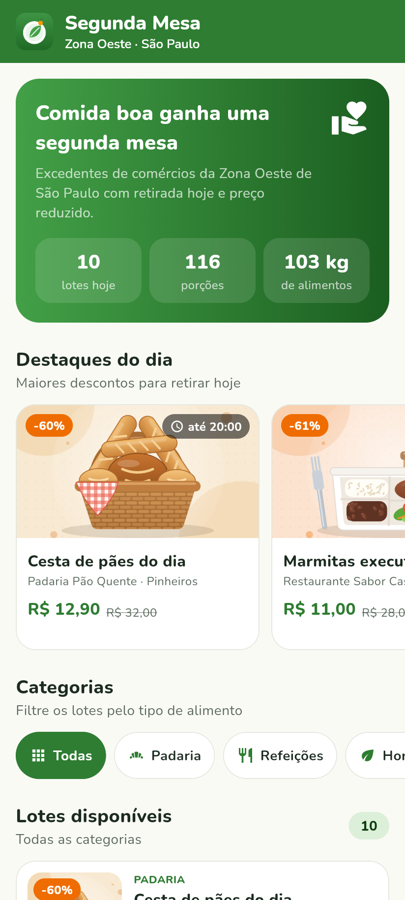
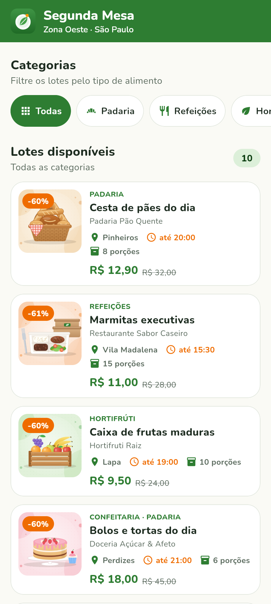
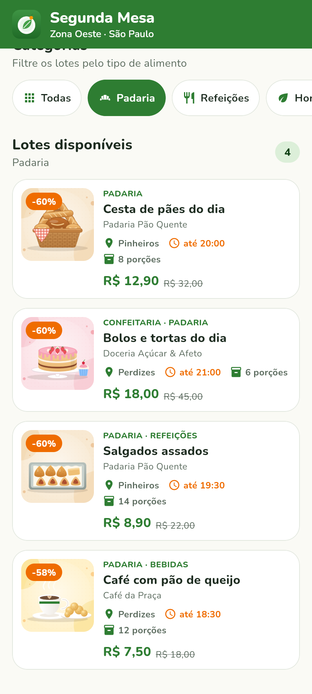
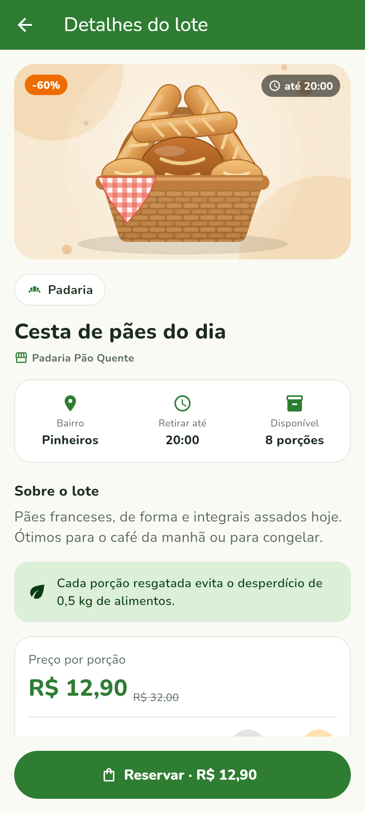
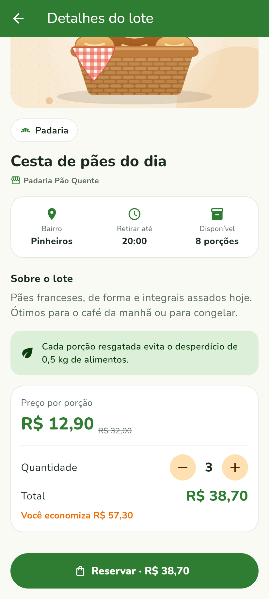
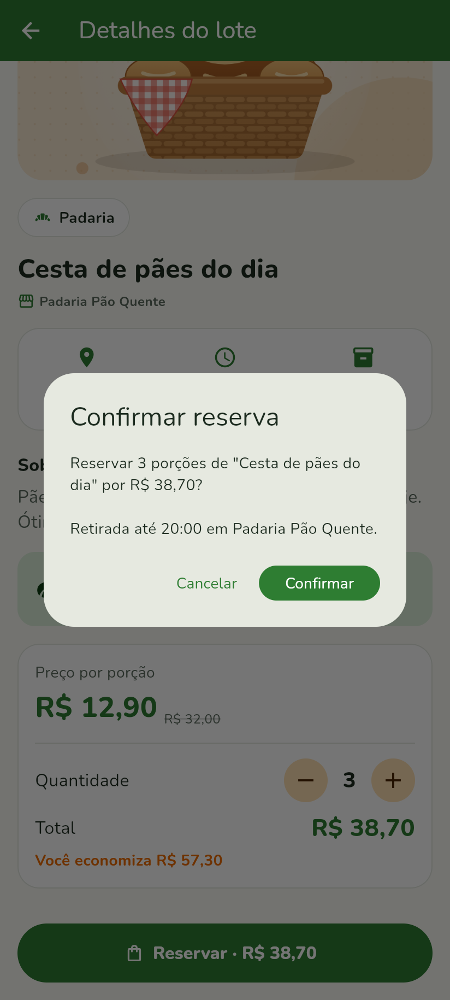
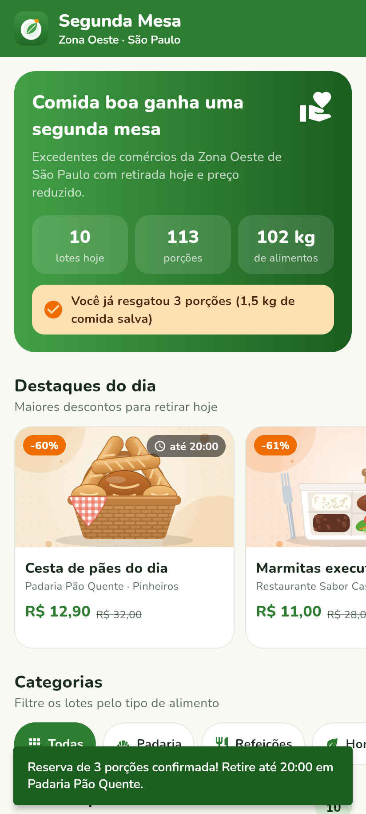
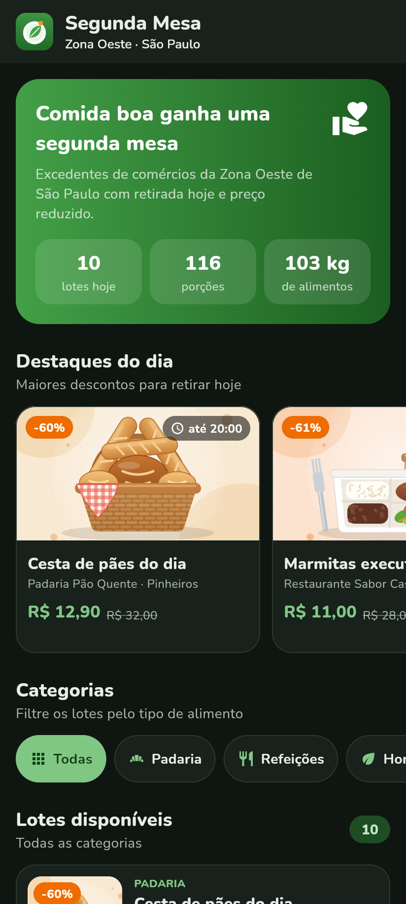

# Segunda Mesa (Flutter)

Global Solution 2026 · CitizenTech · FIAP

O **Segunda Mesa** é um app que conecta comércios com excedente de alimentos a pessoas da Zona Oeste de São Paulo. A comida que sobraria no fim do dia é vendida em lotes com desconto e retirada no mesmo dia.

Esta é a versão em Flutter do app que o grupo também desenvolveu em Kotlin (Jetpack Compose), com o mesmo tema e os mesmos dados.

## Desenvolvedores

| RM | Nome completo |
|----|---------------|
| 559513 | Pedro Ribeiro Ramos | https://youtu.be/yR_wishVWz4
| 560032 | Thiago Cardoso Mendes Machado | https://youtu.be/yR_wishVWz4
| 558527 | Ana Julia Reis |

## Tema da Global Solution

**CitizenTech: tecnologia a serviço do cidadão.** O app trata do **combate ao desperdício de alimentos**, ligado aos ODS 2 (Fome Zero) e 12 (Consumo e Produção Responsáveis) da ONU.

## Descrição da solução

Padarias, restaurantes, hortifrútis e mercados cadastram o que sobrou do dia como **lotes**, com preço reduzido e horário-limite para retirada. No app, o usuário pode:

- ver um banner com quantos lotes, porções e quilos de comida estão disponíveis hoje;
- ver os **destaques do dia** em uma lista horizontal;
- **filtrar os lotes por categoria** (Padaria, Refeições, Hortifrúti, Confeitaria, Mercearia, Bebidas ou Todas);
- abrir os **detalhes** de um lote, escolher a quantidade de porções e **reservar**.

Depois da reserva, a lista e o banner são atualizados e o app mostra quanto de comida o usuário já salvou.

## Onde estão os requisitos

- **Lista vertical:** `ListView.separated` em `lib/screens/home_screen.dart`. Cada item é um `LoteCard`.
- **Categorias:** lista horizontal em `lib/widgets/categoria_selector.dart`, com a opção "Todas". O filtro é feito com `setState` usando o enum `Categoria`.
- **Destaques:** `ListView.builder` horizontal em `lib/widgets/destaques_section.dart`. Os destaques vêm dos próprios lotes, pelo atributo `destaque`.
- **Modelos e enum:** `lib/models/lote.dart` e `lib/models/categoria.dart`. Um lote pode ter mais de uma categoria.
- **Repositório:** `lib/repositories/lote_repository.dart`.
- **Widgets próprios:** pasta `lib/widgets/`, com um componente por arquivo.

## Fluxo de telas

```
Home ── toca em um lote ──> Detalhes do lote ── Reservar ──> Confirmação ── Confirmar ──> Home atualizada
 │
 └── toca em uma categoria ──> lista de lotes filtrada
```

1. **Home:** banner, destaques do dia, categorias e lista de lotes disponíveis.
2. Tocando em uma **categoria**, a lista mostra só os lotes dela e o chip escolhido fica verde.
3. Tocando em um **lote**, abre a tela de **Detalhes**, onde dá para escolher a quantidade com os botões − e +.
4. Em **Reservar**, aparece um diálogo de confirmação. Ao confirmar, o app volta para a Home com as porções atualizadas e uma mensagem de confirmação.

## Prints das telas

| Home | Categorias e lotes | Filtro "Padaria" |
|:---:|:---:|:---:|
|  |  |  |

| Detalhes do lote | Quantidade e total | Confirmação |
|:---:|:---:|:---:|
|  |  |  |

| Reserva confirmada | Tema escuro |
|:---:|:---:|
|  |  |

## API utilizada

Não usamos API externa. Como o enunciado permite, os dados ficam em memória dentro do `LoteRepository`, separados das telas. As imagens dos lotes ficam na pasta `assets/images` e são carregadas com `Image.asset`.

## Arquitetura

```
lib/
├── main.dart                     # MaterialApp, tema claro/escuro e tela inicial
├── models/
│   ├── categoria.dart            # enum Categoria (rótulo e ícone)
│   ├── lote.dart                 # classe Lote
│   └── resumo_impacto.dart       # números do banner
├── repositories/
│   └── lote_repository.dart      # lista de lotes, filtros e reservas
├── screens/
│   ├── home_screen.dart          # tela inicial (StatefulWidget)
│   └── lote_detalhe_screen.dart  # detalhes e reserva (StatefulWidget)
├── theme/
│   ├── app_colors.dart           # cores do app
│   └── app_theme.dart            # tema claro e escuro
├── utils/
│   └── formatadores.dart         # R$ 12,90 · 0,5 kg · 8 porções
└── widgets/                      # componentes reutilizáveis (StatelessWidget)
    ├── categoria_chip.dart
    ├── categoria_selector.dart
    ├── destaque_card.dart
    ├── destaques_section.dart
    ├── estado_vazio.dart
    ├── etiqueta_horario.dart
    ├── impacto_banner.dart
    ├── info_bloco.dart
    ├── info_item.dart
    ├── lote_card.dart
    ├── lote_imagem.dart
    ├── preco_lote.dart
    ├── secao_titulo.dart
    ├── selo_desconto.dart
    └── seletor_quantidade.dart
```

- **models:** classes que representam os dados. `Lote` tem uma lista de `Categoria` e o atributo `destaque`.
- **repositories:** o `LoteRepository` guarda os lotes e tem os métodos `listarTodos`, `filtrarPorCategoria`, `listarDestaques`, `reservar` e `gerarResumo`. As telas não criam dados.
- **screens:** as telas guardam o estado (categoria escolhida, quantidade) e chamam o repositório.
- **widgets:** componentes que recebem os dados por parâmetro e avisam a tela pelos callbacks (`onTap`, `onCategoriaSelecionada`). Alguns são usados em mais de um lugar, como `LoteImagem`, `PrecoLote`, `SeloDesconto` e `CategoriaChip`.

### Como o filtro funciona

A opção **"Todas"** é representada por `null`, porque "Todas" não é uma categoria de alimento, e sim uma opção do filtro.

```
Usuário toca no chip "Padaria"
      ↓
CategoriaSelector chama onCategoriaSelecionada(Categoria.padaria)
      ↓
HomeScreen chama setState e pede ao repositório a lista filtrada
      ↓
ListView.separated mostra só os lotes que têm Padaria na lista de categorias
```

## Como executar

```bash
flutter pub get
```

```bash
flutter run
```

Para rodar no Chrome:

```bash
flutter run -d chrome
```

Para rodar os testes:

```bash
flutter test
```

Se o build Android der erro de versão do Gradle (Flutter anterior ao 3.44), apague a pasta `android` e recrie com:

```bash
flutter create --platforms=android --org br.com.fiap .
```

## Vídeo pitch

Link do vídeo: **(adicionar o link aqui)**

## Créditos

- Ilustrações dos lotes e logo criadas para este projeto.
- Fonte [Nunito](https://fonts.google.com/specimen/Nunito) (SIL Open Font License).
